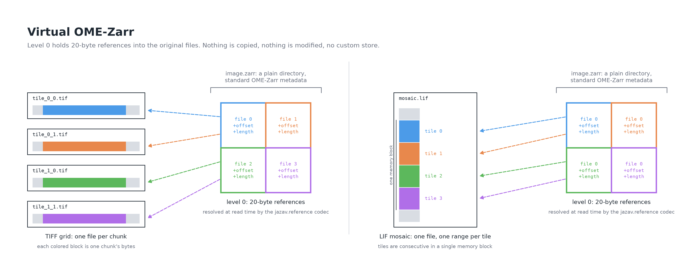

# jazav

Virtual OME-Zarr: a zarr v3 codec that references pixels in the original
microscopy files instead of copying them.

> **Proof of concept.** jazav was written at the 2026 OME-Zarr Hackathon in
> Zurich to play with the idea of virtualization under three constraints:
>
> - **Do not modify the raw data.** The vendor files are read-only inputs; the
>   OME-Zarr points into them, and deleting it leaves them untouched.
> - **Do not use a custom store.** A virtual OME-Zarr is a plain directory on a
>   plain `LocalStore` (or fsspec); only the level-0 array carries a custom
>   codec, so every other part of the hierarchy works with any zarr tool.
> - **Keep everything else standard OME-Zarr.** Pyramid levels, metadata and
>   tables are ordinary, and `jazav materialize` turns the image into a
>   conventional one at any time.
>
> It is not production software: the codec is only readable by zarr-python,
> the on-disk format is frozen at version 2 but has had little use in anger,
> and the vendor-format examples cover a handful of sample files.

A virtual OME-Zarr is a normal OME-Zarr whose level 0 is stored as a few
**reference tables**: one 20-byte entry (source file, byte offset, byte length)
per chunk, pointing into the original files, which are never modified. The
`jazav.reference` codec, discovered through the `zarr.codecs` entry point, reads
a table once and resolves the references at read time, merging adjacent byte
ranges into single requests. Pyramid levels above 0 hold real pixels, built by
reading level 0 through the codec.



## Install

```bash
pip install jazav            # codec + helpers; depends on zarr only
pip install "jazav[examples]"  # ngio, tifffile, liffile, czifile, nd2 for examples/
```

Requires Python >= 3.12 and zarr >= 3.2.1.

## Reading

Nothing to do. Once `jazav` is installed, every reader built on zarr-python
(ngio, ome-zarr-py, napari-ome-zarr, dask, plain `zarr.open`) reads a virtual
OME-Zarr like any other:

```python
import zarr

image = zarr.open_group("plate.zarr/B/03/0", mode="r")
level0 = image["0"][:]  # resolved from the original files on the fly
```

Readers that do not use zarr-python (zarrs, TensorStore, zarr-java, JavaScript
viewers) see an unknown codec on level 0 and still read the other levels. That
reader scope is accepted; `jazav materialize` removes the dependency entirely.

## Writing

```python
import zarr
import jazav

group = zarr.open_group("image.zarr", mode="r+")
array_dir = "image.zarr/0"
sources = jazav.normalize_sources(
    [jazav.relative_source_path(array_dir, f) for f in ("raw/A01_f0.tif", "raw/A01_f1.tif")]
)
array = jazav.create_reference_array(
    group, "0",
    shape=(1, 1, 1024, 2048), chunks=(1, 1, 1024, 1024), dtype="uint16",
    fill_value=0, dimension_names=("c", "z", "y", "x"),
    sources=sources, sizes=[8388744, 8388744],
    codecs=[{"name": "bytes", "configuration": {"endian": "little"}}],
)
jazav.write_references(array, {(0, 0, 0, 0): (0, 136, 2097152), (0, 0, 0, 1): (1, 136, 2097152)})
```

`chunks` is the shape of one stored block. Every level-0 chunk must be exactly
one stored block of one source file: blocks must sit on the chunk grid without
overlap. The array's zarr chunks are *shards*, each holding one reference table;
by default the whole array is one shard while it has at most 16,384 chunks, and
larger arrays are split along the slowest axes first, leaving y and x whole.
Pass `shards=` to choose, e.g. one shard per plane. `write_references` writes
whole tables, so call it once with all the references. The `examples/` scripts
show this for a TIFF grid and for Leica LIF, Zeiss CZI and Nikon ND2 files,
building the container with ngio.

Note that `array.chunks` reports the shard shape, as zarr does for any custom
codec; the block shape is `jazav.reference_codec(array).chunk_shape`. Dask built
on `array.chunks` therefore sees one task per shard.

## Commands

```bash
jazav verify image.zarr          # sources exist, sizes match, references in range
jazav verify --deep image.zarr   # also decode every chunk
jazav materialize image.zarr     # rewrite level 0 in place as a regular array
```

Both are also plain functions: `jazav.verify(path)` returns a report with
`.ok` and `.problems`; `jazav.materialize(path)` returns the rewritten paths.
`materialize` copies chunk by chunk into a sibling array and swaps it in with
two renames; if it is interrupted in between, a `<level>-virtual-old` directory
is left next to the array and renaming it back restores the references.

## Reference format, version 2 (frozen)

The array's zarr chunk grid is the **shard** grid. Each stored shard key holds a
reference table: `20 * n` bytes for a shard of `n` inner chunks (always the full
size, also for shards that extend past the array's edge), one entry per inner
chunk in C order over the shard's inner chunk grid. An entry is
`struct.Struct("<IQQ")`:

| offset | size | field           | meaning                                       |
|--------|------|-----------------|-----------------------------------------------|
| 0      | 4    | `uint32 source` | index into the codec's `sources` table        |
| 4      | 8    | `uint64 offset` | byte offset of the stored block in the source |
| 12     | 8    | `uint64 length` | byte length of the stored block               |

An entry of twenty `0xFF` bytes marks an inner chunk without a block; it reads as
`fill_value`, and so does every inner chunk of a shard key that does not exist.
The source index `0xFFFFFFFF` is reserved for that entry and `length` is never 0.
Level-0 `zarr.json`: the reference codec is the **only** codec (`filters: []`,
`compressors: []`), default chunk-key encoding with separator `/`, and
`chunk_grid.chunk_shape` (the shard shape) is a multiple of the codec's
`chunk_shape`:

```json
{"name": "jazav.reference",
 "configuration": {
   "version": 2,
   "chunk_shape": [1, 1, 1024, 1024],
   "sources": ["../../../raw/A01_f0.tif", "../../../raw/A01_f1.tif"],
   "sizes": [8388744, 8388744],
   "codecs": [{"name": "bytes", "configuration": {"endian": "little"}}]}}
```

- `chunk_shape`: the inner chunk shape, i.e. the shape of one stored block.
- `sources[i]`: `/`-separated path relative to the array's key prefix, may start
  with `..`; rejected if absolute, has a URL scheme, contains `\`, or has empty
  or `.` segments. Deduplicated and sorted when written.
- `sizes[i]`: byte size of each source at write time. The codec compares it with
  the real file once per source before the first read, so a truncated or replaced
  file is refused instead of decoded into garbage. Checked for local and fsspec
  stores; other stores rely on strict byte-range reads.
- `codecs`: the nested zarr v3 chain that turns one block's raw bytes into the
  inner chunk array, identical for every chunk of the array: `[bytes]`,
  `[transpose, bytes]` for blocks stored in another axis order, `[bytes, zstd]`
  or `[bytes, numcodecs.zlib]` for compressed blocks.
- The codec name `jazav.reference` and this layout are frozen. An unknown
  `version` raises an error naming the installed `jazav` version.

## How it works, and what it relies on

zarr-python routes a read through a codec's partial-decode hook only when the
array's sole codec is an array-to-bytes codec that implements
`ArrayBytesCodecPartialDecodeMixin`. That hook receives the store path of the
shard and the selection within it, which is what lets the codec read the table,
resolve the sources relative to the array and issue byte-range requests on them.
Hence the single-codec rule. The table is decoded once per shard and cached in
the codec (level 0 is read-only); blocks of one source that lie within 1 MiB of
each other are read with one range request of at most 64 MiB; inner chunks are
decoded through zarr's own codec pipeline, as `sharding_indexed` does. Sources
above the store root are reached by opening a read-only parent `LocalStore` or
`FsspecStore`; other store types must be opened at a root that contains the
sources. The codec is picklable for dask's process schedulers.

Why tables rather than one reference file per chunk (format 1): a read then
needed two dependent store requests per chunk, which doubled the request count on
object storage and put one tiny file per chunk on network filesystems. On a local
disk, a 256-chunk read took 239 ms against 127 ms for a plain zarr; with tables
and coalescing it takes 68 ms.

Semi-private zarr APIs used: `StorePath`, `parse_named_configuration`,
`parse_codecs`, `get_pipeline_class`, `zarr.core.sync.sync`,
`default_buffer_prototype`. The test suite runs against the zarr floor
(3.2.1) and the latest release, and `create_reference_array` refuses to
create an array that the installed zarr would not route through partial
decoding.

## Examples

`examples/` holds one script per format. Each builds a virtual OME-Zarr with
ngio next to a copying conversion of the same pixels, checks that both read
identically (level 0 against the vendor reader, levels above against the copy),
runs `verify`, and prints one row per image. Results on the sample files
(`pixi run -e dev example-all`, 2026-11-05):

| script | input | result |
|---|---|---|
| `tiff_grid.py` | 2x2 grid of uncompressed TIFF tiles, same grid as `.npy` | virtual, 30 KiB vs 61 KiB copy |
| `tiff_grid.py` | zlib-compressed TIFF tiles | not virtualizable (compressed) |
| `leica_lif.py` | `hcs_2w1p3c5z1t.lif`, 2 images, 4 mosaic tiles of `(3, 5, 256, 256)` uint8 | virtual, one range per tile, no transpose |
| `zeiss_czi.py` | `hcs_2w2p2c1z1t_pos.czi`, 4 scenes, ZSTD1 subblocks | virtual as `[bytes, zstd]` past the 3-byte header |
| `zeiss_czi.py` | `img_4p2c1z1t_ManuallyDrawnRegion.czi` | not virtualizable (subblock at y=115 is off the 128-pixel grid) |
| `nikon_nd2.py` | 7 uncompressed files, frames stored `(y, x, c)` | virtual with `[transpose, bytes]` (nd2 0.12.0, private `_frame_offsets`) |

What qualifies: every level-0 chunk is exactly one stored block of one source
file, so the chunk shape is the block shape and blocks must sit on the chunk
grid without overlap. TIFF needs a contiguous uncompressed series; LIF a
contiguous memory block with the mosaic dimension slowest; CZI uncompressed,
ZSTD0 or ZSTD1 subblocks without hi-lo byte unpacking; ND2 no lossy
compression and no padded rows. Compressed PNG/JPEG tiles, JPEG-XR CZI
subblocks and lossy ND2 are never virtualizable. The ND2 `lossless` (zlib)
path is implemented but unverified for lack of a sample.

## Development

```bash
pixi install
pixi run -e dev test-all    # py3.12 + zarr 3.2.1 and py3.13 + latest zarr
pixi run -e dev chores      # format, tests, lint, type check
pixi run -e dev example-tiff
```

### A committed sample

`samples/tiff_grid` holds a small virtual OME-Zarr built by `examples/tiff_grid.py`:
four uncompressed 64x64 uint16 TIFF tiles under `raw/tiff/` and the image under
`tiff/virtual.zarr`, whose level 0 is one shard whose 80-byte table references
the four tiles. It is the format's
regression fixture (`tests/test_sample.py`), a quick thing to look at, and an
easy `verify`/`materialize` target:

```bash
pixi run -e dev jazav verify samples/tiff_grid/tiff/virtual.zarr
pixi run -e napari napari-sample   # open it in napari
```

To regenerate it, run `python examples/tiff_grid.py --out DIR` and copy
`DIR/raw/tiff` and `DIR/tiff/virtual.zarr` back into place.

### Checking a viewer

The `napari` environment adds napari, Qt and napari-ome-zarr (which reads
through ome-zarr-py and zarr-python, so the codec is picked up with no
viewer-side change):

```bash
pixi run -e napari napari-tiff   # build the TIFF example and open it in napari
pixi run -e napari python examples/napari_view.py path/to/virtual.zarr
pixi run -e napari napari --plugin napari-ome-zarr path/to/virtual.zarr   # same, no script
pixi run -e napari test-napari   # headless: the napari-ome-zarr reader returns the right pixels
```
